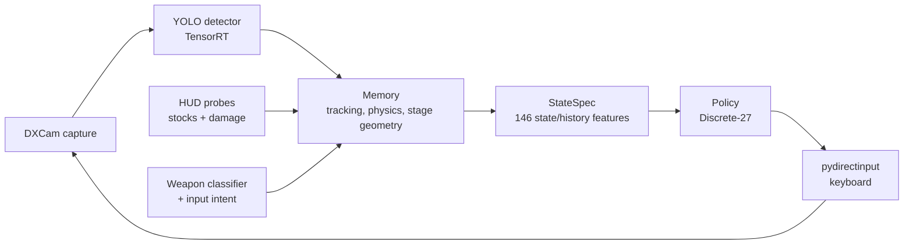

# brawl: vision-only reinforcement learning in a live game

An agent that plays Brawlhalla from **screen pixels alone**: no memory reading, no game API, no
emulator. It runs on a single laptop (RTX 3050 Ti, 4 GB VRAM). Each step captures the screen,
detects fighters and weapons with YOLO, updates a structured game state, reads stocks and damage
from the HUD, and injects keyboard input.

**Research question.** Being defined in `research/HYPOTHESIS.md` (next step). Everything produced before it (seven pipeline generations) is kept under `legacy/` and
summarized, with its results and decisions, in [research/LAB_NOTEBOOK.md](research/LAB_NOTEBOOK.md).


## Why this is hard

| Constraint | Consequence |
|---|---|
| No memory access | Every state variable must be recovered from pixels |
| No emulator, no pause | The game runs in wall-clock time and cannot be stepped or sped up |
| Cannot reset the match | Episode boundaries are logical; the world keeps going |
| One game instance | No parallel environments; about 26-30 control steps per second, detector-bound |
| 4 GB VRAM | Detector and policy share one small GPU |

About 27 steps/s is roughly 2.4M environment steps per day of continuous play, so sample
efficiency per interaction and per wall-clock hour is the binding constraint. Detection is about
93% of each step ([docs/performance.md](docs/performance.md)).

## Install

Windows, Python 3.12, a CUDA 12.x GPU, and Brawlhalla in Training Mode at 1920x1080. torch must
come from the PyTorch CUDA index, in its own command ([docs/setup.md](docs/setup.md) explains why).

```powershell
python -m pip install torch torchvision --index-url https://download.pytorch.org/whl/cu126
python -m pip install -r requirements.txt
python -m pip install -e .
python -m pytest            # about 935 tests, 2 minutes; no game needed
```

## Quickstart

```powershell
python scripts/ops/check_capture.py                           # screen capture and detector on this machine
python scripts/llc/llc_preflight.py --device cuda             # files, packages, GPU, calibration
python scripts/llc/debug_observation_overlay.py --phase movement_fluency --show --max-steps 1000
```

Check perception with the overlay before training anything: if the overlay is wrong, everything
downstream is wrong.

## How one step works



`brawl/env/live.py` runs this loop; [docs/architecture.md](docs/architecture.md) and
[docs/observation-space.md](docs/observation-space.md) describe each stage.

## Pipelines

Each pipeline generation (era) has its own subpackage, scripts, configs, outputs and docs, all under
the same name. None is the research method yet; they are the starting material for it.

| Era | What it is | Status | Entry point | Docs |
|---|---|---|---|---|
| `llc` | Goal-conditioned skill curriculum: teacher demos, BC, anchored-replay PPO, retention gates | Superseded | `python -m brawl.pipelines.llc.train_curriculum` | [llc](docs/pipelines/llc/) |
| `final_agent` | One goal-free policy on full-match reward, initialized from the skill policy | Stalled | `python -m brawl.pipelines.final_agent.run` | [final_agent](docs/pipelines/final_agent/) |
| `semantic57` | 57 macro actions with masked PPO | Parked | `python -m brawl.pipelines.semantic57.run` | [semantic57](docs/pipelines/semantic57/) |
| `primitive27` | Integrated teacher, pooled BC, plain PPO on Discrete(27) | Frozen baseline | `python -m brawl.pipelines.primitive27.run` | [primitive27](docs/pipelines/primitive27/) |
| `round_a` | Information and memory benchmark: mlp, recurrent and multi (RGB + state) candidates | Last active | `python -m brawl.pipelines.round_a.run` | [round_a](docs/pipelines/round_a/) |
| `weapon_classifier` | Weapon-possession crop classifier | In use | `python -m brawl.pipelines.weapon_classifier.train` | [diagnostics](docs/pipelines/final_agent/diagnostics.md) |

Every entry point takes `--help`. Run them from any folder: default paths are anchored at the
repository root ([brawl/paths.py](brawl/paths.py)).

## Repository layout

```
brawl/                  the package (pip install -e .)
  capture/              DXGI / GDI screen capture; capture_first.py must load before torch
  perception/           YOLO wrapper, weapon classifier, weapon evidence fusion
  state/                Memory (tracking, physics), StateSpec, canonicalization, detection schema
  control/              Discrete(27) action space, input injection, tap scheduling, semantic actions
  reward/               HUD decoding (stocks, damage), reward providers, match objective
  env/                  live.py (the live-game env), match.py (match-reward wrapper)
  training/             shared: checkpoints, runner, CLI, experiment config, teachers, curriculum goals
  algo/                 AnchoredReplayPPO (replay, KL anchor, BC loss, PCGrad)
  pipelines/<era>/      one subpackage per pipeline generation (table above)
  analysis/             figures and paper evidence from run outputs
  world_model/          world-replay recorder
  paths.py, compat.py   repository locations; loading checkpoints saved before this layout
scripts/                tools you run directly: ops/ (capture, calibration, probes), llc/, round_a/, final_agent/
configs/legacy/<era>/   protocols and experiment files from before the hypothesis
tests/                  unit and integration tests (CI runs them without the game)
docs/                   how the system works, and docs/pipelines/<era>/ per pipeline
research/               LAB_NOTEBOOK.md, paper/ (LaTeX), reports/, notebooks/, archive/
results/legacy/<era>/   committed summaries and figures from before the hypothesis
assets/                 YOLO weights (Git LFS), reference screenshots
runs/                   training outputs, git-ignored (runs/legacy/<era>/ for existing runs)
data/                   datasets, demos, world replay, frozen input models (data/models/), git-ignored
```

The research harness from the PADP project (`configs/base.yaml`, `configs/experiments/*.yaml`,
`scripts/{train,sweep,analyze}.py`, `runs/<experiment>/<variant>/seed<k>/`,
`results/<experiment>/summary.md`) comes with the first pipeline built for the hypothesis.

## Outputs

| What | Where |
|---|---|
| A training run | `runs/legacy/<era>/<run>/` (Round A, primitive27, semantic57 and the final agent each write a run folder; LLC writes flat files into `runs/legacy/llc/`) |
| Diagnostics, profiles, debug videos | `runs/legacy/<era>/` |
| Weapon classifiers and other frozen inputs | `data/models/` |
| World replay | `data/world_replay/` |
| Curated summaries | `results/legacy/<era>/` |

Checkpoints saved before the 2026-11-02 restructure still load: `brawl.compat.load_sb3()` maps
their old module paths (for example `train.round_a_models`) to the current ones.

## Known issues

1. **PPO fine-tuning has made the BC initialization worse in every pipeline so far** (Round A:
   -1.2 net stocks per minute after 50k steps, one seed). Not yet explained; see the lab notebook.
2. **Weapon possession is fused from a crop classifier and input intent**, not observed directly;
   the classifier is not yet validated as ground truth.
3. **PPO updates do not pause the game**, so the agent is idle during each update (logged as
   update-gap transitions).
4. **The action space cannot express direction-modified attacks**, so much of the moveset is
   unreachable.
5. **`yolo_infer_every_n_steps` is not honoured** by the step loop; reusing stale boxes would
   collapse velocity estimates, so the fix must skip the state update too.
6. **Opponent weapon state is unavailable** under the 3-class detector schema.

## Documents

- [docs/setup.md](docs/setup.md): environment, CUDA, TensorRT engine build
- [docs/architecture.md](docs/architecture.md): pipeline internals
- [docs/observation-space.md](docs/observation-space.md): every state dimension and its provenance
- [docs/experiment-workflow.md](docs/experiment-workflow.md): how a method is added and recorded
- [docs/pipelines/](docs/pipelines/): one folder per pipeline generation
- [research/LAB_NOTEBOOK.md](research/LAB_NOTEBOOK.md): what was run, what came out, what was decided
- [research/paper/](research/paper/): working manuscript (August 2026, goal-conditioned skills)

## License

MIT, see [LICENSE](LICENSE).
