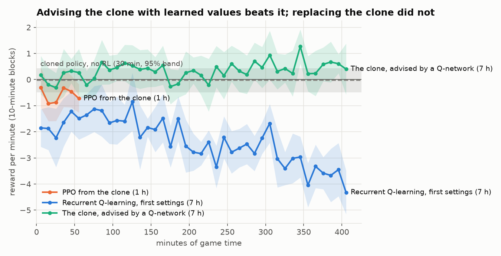
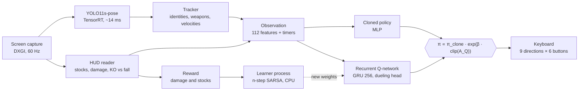

# brawl: a reinforcement-learning agent that plays a live fighting game from the screen

An agent that plays Brawlhalla against the game's built-in bots using **only what a human gets**: the
pixels on the screen and the keyboard. No memory reading, no game API, no emulator, no speed-up or
pause. Everything runs in real time on one laptop (RTX 3050 Ti, 4 GB VRAM), deciding 20 times a
second.

**Current result.** The agent starts from a cloned human policy, and a recurrent Q-network learns
online, while the agent plays, how to shift that policy's choices. Against the Medium bot, the advised
agent scores **+0.50 reward per minute**, against **−0.08** for the cloned policy alone. That is
**20 stocks taken to 14 lost, against 15 to 16**, and **6 virtual matches won to 1, against 4 to 3**. Each
was measured in 30 minutes of frozen-policy play (6 × 5 min blocks, back to back:
[results/play/](results/play/)). The same gap held during training: +0.38 ± 0.06 against −0.11 ± 0.19
over a 7-hour night. Over a 10-hour night the advised agent is even on stocks with the Medium bot (399 taken, 386 lost) and ahead on damage; a third of the stocks it loses are its own failed recoveries, the next thing to fix.



*Each line is one overnight run in the live game (10-minute blocks, 95% bands). The grey band is the
cloned policy without learning. Two baselines fell below it: PPO fine-tuning (red) and plain
recurrent Q-learning (blue). Keeping the clone and letting a Q-network advise it (green, orange) is the
first method that beat it.*

## How it works



1. **Perception.**
   - A YOLO11s pose model finds both fighters and the weapons. I trained it on hand-labelled frames.
     It is exported to a TensorRT FP16 engine and runs in about 14 ms a frame.
   - A tracker keeps the fighters' identities and estimates their velocities.
   - It passed a held-out gate ([results/gates/](results/gates/)): fighters found 98.6–100% of the
     time, identity swaps at or below 0.7%, position error p95 at or below 15 px at 1920×1080.
2. **Game state.**
   - The HUD reader recovers stocks and damage from pixels.
   - A ledger tells KOs apart from self-inflicted falls.
   - The observation has 112 entries: positions, velocities, damage, weapons, stage geometry and
     action timers.
3. **Imitation.**
   - I recorded under 2.5 hours of my own play.
   - The policy clones only the stretches that ended in a stock taken.
4. **Learning online: the "advised clone".**
   - The agent samples from the clone's distribution, re-weighted by a recurrent Q-network's
     advantages. The advantages are bounded, and the weighting ramps in after a 30-minute baseline.
     This is a KL-regularised policy-improvement step, as in MPO and AWR.
   - The Q-network learns by 20-step SARSA in a separate process while the game keeps running, so play
     never waits for training.
   - Safeguards for unattended 7–10 h runs:
     - keep the best weights from any half-hour, and roll back to them if play falls by 1.0 reward a
       minute;
     - a watchdog that stops the run when the HUD goes unread;
     - per-decision traces.

## What did not work, and why that mattered

Every result, including the negative ones, is in [research/LAB_NOTEBOOK.md](research/LAB_NOTEBOOK.md).

| Attempt | Outcome | Reading |
|---|---|---|
| PPO fine-tuning from the clone | Worse within an hour | Policy-gradient noise from one slow real-time environment destroys the clone faster than it learns |
| Recurrent Q-learning, acting greedily | −2 to −4 reward per minute | First copied its own last action. Then its values inflated overnight (−1.85 → −4.3). Then it stood still once exploration stopped |
| Uniform exploration | The fighter threw its weapon away | Replaced by exploring with the human's action frequencies |
| Fighter crops (CNN) added to the vector state | Worse value estimates (lose AUC 0.61 against 0.73) | Overfits on 2.5 h of data; the vector already carries what the crops show |
| Distilling the advised play into a new clone | No better than the original clone (−0.09 ± 0.10 over a 10 h A/B night, alternating every 5 min) | The online advisor, not the base policy, is the bound |

## Engineering

- **Real time, one instance:**
  - Capture, perception and policy take 25 ms median per decision (p95 34 ms, against a 50 ms budget);
  - 0.15% of decisions miss the budget.
  - Every call is counted, so one frame gets exactly one grab, one detection and one step.
- **Reproducible experiments:**
  - YAML configs ([configs/base.yaml](configs/base.yaml), [configs/experiments/](configs/experiments/));
  - `runs/<experiment>/<variant>/seed<k>/`, with per-block CSVs and the git commit in `meta.json`;
  - [scripts/analyze.py](scripts/analyze.py) and [scripts/plot_results.py](scripts/plot_results.py) for summaries and figures;
  - a lab notebook and a checklist.
- **Offline benchmarks before every overnight run:**
  - the value network on held-out human sessions: correlation with the real return, AUC for lost
    and won stocks ([scripts/value_bench.py](scripts/value_bench.py));
  - probes of which inputs help ([results/probes/](results/probes/)).
- **1,000+ tests**, run in CI without the game: fake game and capture, the full live loop with a
  learner process.

## Run it

Windows, Python 3.12, a CUDA 12 GPU, and Brawlhalla in Training Mode at 1920×1080 (Wu Shang vs a
Mordex bot, Brawlhaven small, camera Fixed).

```powershell
python -m pip install torch torchvision --index-url https://download.pytorch.org/whl/cu126
python -m pip install -r requirements.txt
python -m pip install -e .
python -m pytest                                                     # no game needed

python scripts/export_detector.py runs/detector/armed_yolo11s-pose_960/weights/best.pt   # TensorRT engine
python scripts/record_demos.py --difficulty medium                   # record your own play
python scripts/prepare_demos.py
python scripts/train_bc.py --name medium_v1 --difficulty medium
python scripts/train.py --config configs/experiments/rdqn_medium_v3.yaml   # the advised clone, overnight
python scripts/analyze.py rdqn_medium_v3
python scripts/plot_results.py
```

[docs/setup.md](docs/setup.md) covers CUDA and the TensorRT build.

## Layout

```
brawl/
  game/          screen capture, frame clock, keyboard
  sense/         detector, tracker, HUD reader
  observation.py, actions.py, ledger.py, brawlenv.py    the environment
  learn.py       behaviour cloning, PPO, the live Q-learning loop
  rdqn.py        recurrent Q-network, replay, learner process, the advised policy
  vision.py      fighter crops (for the vision experiments)
  pipelines/     earlier generations of the project, kept for reference
scripts/         train, play, analyze, plot, benchmarks, data preparation
configs/         base.yaml and one file per experiment
results/         committed summaries and figures
research/        LAB_NOTEBOOK.md, CHECKLIST.md, paper drafts
tests/
```

**Earlier generations.** The project went through several approaches before this one:
- a goal-conditioned skill curriculum;
- macro-action PPO;
- a representation benchmark.

They live in `brawl/pipelines/` and `results/legacy/`, with their docs in [docs/pipelines/](docs/pipelines/).

## License

MIT, see [LICENSE](LICENSE).
